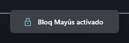
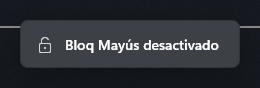
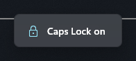

# lock-osd

Windows 11 on-screen indicator for Caps Lock, Num Lock and Scroll Lock, like the one laptop vendors ship.
WinUI 3 (Windows App SDK) on .NET 10: acrylic backdrop, system theme and accent, Segoe Fluent Icons.

The OSD is click-through, never takes focus, and appears on the display of the foreground window. It polls
key state with `GetKeyState`, so there is no global keyboard hook and it never sees what you type.





## Install

Requires Windows 11 22H2 or later, x64.

Download the latest `LockOsd-Setup-<version>-x64.exe` from
[Releases](https://github.com/edglz/lock-osd/releases) and run it. It installs for the current user, without admin
rights, and starts with Windows. It also needs the
[.NET 10 Desktop Runtime](https://dotnet.microsoft.com/download/dotnet/10.0). The installer is not signed, so
SmartScreen may warn you.

With winget, from a clone of this repository. The package is not in the public winget catalog, so local manifests
must be enabled once, from an elevated terminal:

```powershell
winget settings --enable LocalManifestFiles
winget install --manifest winget
```

This path also installs the .NET runtime if it is missing.

## Configuration

Settings are in `%APPDATA%\LockOsd\config.yaml`, created on first run. Changes apply when you save the file. If it
has an error, the app keeps its previous settings and writes the reason to `%LOCALAPPDATA%\LockOsd\events.log`.

```yaml
language: auto        # auto follows the Windows display language

keys:
  capsLock: true
  numLock: true
  scrollLock: true

display:
  durationMs: 1600    # 300 to 30000
  position: bottom    # bottom or top
  marginDip: 24       # distance from the screen edge, 0 to 1000
  monitor: active     # active follows the foreground window, primary uses the main display
```

## Languages

English (`en`) and Spanish (`es`) are built in. `es-MX` falls back to `es`, and anything unknown to English.

To add or override a language, create `%APPDATA%\LockOsd\locales\<code>.yaml`. Missing values use English:

```yaml
capsLock: Verr. Maj
numLock: Verr. Num
scrollLock: Arrêt défil
enabled: "{key} activé"
disabled: "{key} désactivé"
```

To include a language in the app, add the same file to `locales` in this repository.

## Support

If this is useful to you, you can [buy me a coffee](https://buymeacoffee.com/edggdev).

## License

[MIT](LICENSE)

## Motion

`WindowMotion` slides and fades the real window, so the acrylic moves with it. Frames are paced by the compositor
clock at the display refresh rate, and a new key press reverses an animation from its current values. Curves and
durations are the Fluent values from the Windows App SDK theme resources. A state change while the OSD is visible
crossfades the content on the compositor thread. Windows "Animation effects" being off disables all of it.

## Build

```powershell
dotnet build LockOsd.csproj -c Release -o dist
```

Use `build -o`, not `publish`: `dotnet publish` leaves `LockOsd.pri` and the `.xbf` files out of the output,
and the app then dies at startup with `XamlParseException`. Stop the running instance first, it locks `dist`.

Needs the .NET 10 Desktop Runtime. The Windows App SDK is bundled in `dist`.

## Package

Needs Inno Setup (`winget install JRSoftware.InnoSetup --scope user`). Build `dist` first, then:

```powershell
& "$env:LOCALAPPDATA\Programs\Inno Setup 6\ISCC.exe" installer\LockOsd.iss
(Get-FileHash artifacts\LockOsd-Setup-<version>-x64.exe -Algorithm SHA256).Hash
```

The installer is per-user, needs no admin rights, and goes to `%LOCALAPPDATA%\Programs\LockOsd`. It registers
`LockOsd` under `HKCU\Software\Microsoft\Windows\CurrentVersion\Run`, starts the app, and stops a running copy
before upgrading or uninstalling.

To release a version, change it in `LockOsd.csproj`, `installer\LockOsd.iss` and `winget\*.yaml`, and put the new
hash in `winget\edglz.LockOsd.installer.yaml`. Check with `winget validate --manifest winget`. `InstallerUrl` must
point to a public download.

## Stop or remove

There is no tray icon. Uninstall from Windows Settings, or stop the app until the next sign-in:

```powershell
Stop-Process -Name LockOsd
```

## Troubleshooting

Logs are in `%LOCALAPPDATA%\LockOsd`:

- `crash.log`: unhandled exceptions.
- `events.log`: process start and exit, and lock key changes. A forced kill leaves no exit line.

If the OSD stops appearing, a recent `key` line means the key was detected and the problem is in the display. No
`key` line, with the process still running, means detection stopped.
